# 🍽️ Smart Canteen Ordering Application

A full-stack web application that makes canteen food ordering easier for students and helps administrators manage food items, orders, inventory, and sales.

## 📌 Project Overview

The Smart Canteen Ordering Application allows students to browse available food items, search the menu, add items to a cart, place orders, and track their order status.

Administrators can manage the food menu, update availability, manage customer orders, monitor inventory, and view sales information through an admin dashboard.

The application is built using React.js, Node.js, Express.js, and MySQL.

## ✨ Features

### 👨‍🎓 Student Features

* Student registration and login
* Secure authentication using JWT and bcrypt
* Browse the food menu
* Search and filter food items
* View food prices and availability
* Add food items to the shopping cart
* Update item quantities and view the total amount
* Place food orders
* Select a payment method
* Track order status
* View order history and order details
* Receive order status notifications
* Ask canteen-related questions using the chatbot

### 🛠️ Admin Features

* Admin login and role-based access control
* Admin dashboard
* Add, update, and manage food items
* Manage food categories and prices
* Update food availability
* View and manage customer orders
* Update order status
* Monitor food inventory
* View sales reports
* Identify popular food items

### 🤖 AI and Future Enhancements

The project provides a foundation for future AI-powered improvements, including:

* LLM-powered menu assistance
* Retrieval-Augmented Generation (RAG) using actual menu data
* Personalized food recommendations
* AI-assisted sales analysis

These are planned enhancements and should not be considered implemented unless they are added and tested.

## 🧰 Technologies Used

| Technology         | Purpose                       |
| ------------------ | ----------------------------- |
| HTML5              | Web page structure            |
| CSS3               | Styling and responsive design |
| JavaScript         | Application logic             |
| React.js           | Frontend user interface       |
| Node.js            | Backend JavaScript runtime    |
| Express.js         | REST API and backend routing  |
| MySQL              | Relational database           |
| mysql2             | Node.js–MySQL connection      |
| JWT                | Authentication tokens         |
| bcrypt             | Password hashing              |
| Postman            | API testing                   |
| Git                | Version control               |
| GitHub             | Source code hosting           |
| Visual Studio Code | Development environment       |

## 🏗️ Project Structure

```text
Smart-Canteen-Ordering-App/
│
├── backend/
│   ├── uploads/
│   │   └── foods/
│   ├── authMiddleware.js
│   ├── db.js
│   ├── roleMiddleware.js
│   ├── server.js
│   ├── package.json
│   └── .gitignore
│
├── frontend/
│   ├── public/
│   ├── src/
│   │   ├── components/
│   │   │   └── Chatbot.jsx
│   │   ├── App.jsx
│   │   ├── App.css
│   │   ├── index.css
│   │   └── main.jsx
│   ├── package.json
│   └── .gitignore
│
├── .gitignore
└── README.md
```

## ⚙️ Prerequisites

Install the following software before running the application:

* [Node.js](https://nodejs.org/)
* [MySQL Community Server](https://dev.mysql.com/downloads/mysql/)
* [Visual Studio Code](https://code.visualstudio.com/)
* [Git](https://git-scm.com/)

You can use Postman to test the backend APIs.

## 🚀 Installation and Setup

### 1. Clone the Repository

Open a terminal and run:

```bash
git clone https://github.com/JAYA-C7/Smart-Canteen-Ordering-App.git
```

Move into the project directory:

```bash
cd Smart-Canteen-Ordering-App
```

### 2. Set Up the MySQL Database

Start your MySQL server and create the application database:

```sql
CREATE DATABASE smart_canteen;
```

The application also requires the database tables and relationships used by the backend, including users, categories, food items, orders, order items, payments, inventory logs, and notifications.

Create those tables using the application's database schema before starting the application.

**Note:** A database schema export should be added to this repository to make database setup reproducible for new developers.

### 3. Configure the Backend

Open a terminal in the backend directory:

```bash
cd backend
```

Install the backend dependencies:

```bash
npm install
```

Create a `.env` file inside the `backend` directory. Configure the database connection and authentication settings using your own local credentials.

Example configuration:

```env
DB_HOST=localhost
DB_USER=your_mysql_username
DB_PASSWORD=your_mysql_password
DB_NAME=smart_canteen
DB_PORT=3306
JWT_SECRET=replace_with_a_long_random_secret
```

Replace the example values with your actual local configuration. Do not commit your real `.env` file or share database passwords and JWT secrets publicly.

### 4. Start the Backend Server

From the `backend` directory, run:

```bash
npm start
```

The backend should run at:

```text
http://localhost:3000
```

If the start command is unavailable, check the scripts in `backend/package.json`.

### 5. Configure and Start the Frontend

Open a **second terminal** in Visual Studio Code.

Move into the frontend directory from the project root:

```bash
cd frontend
```

Install the frontend dependencies:

```bash
npm install
```

Start the React development server:

```bash
npm run dev
```

Open the local frontend address shown in the terminal. The current development address is:

```text
http://localhost:5173
```

Keep both backend and frontend servers running while using the application.

## 🗄️ Database

The application uses MySQL to store and manage information about:

* Users and roles
* Food categories
* Food items and availability
* Customer orders
* Order items
* Payment records
* Inventory logs
* Notifications

Relational constraints help maintain consistency between related records.

## 🔐 Security

The application includes:

* Password hashing with bcrypt
* JWT-based authentication
* Authentication middleware for protected routes
* Role-based authorization for administrative operations
* Environment variables for database and authentication configuration
* Git ignore rules to prevent environment files and dependencies from being committed

Never upload passwords, access tokens, private keys, or production credentials to GitHub.

## 🧪 Testing

The application has been tested manually during development, including:

* Registration and login
* Authentication and protected routes
* Food menu display, search, and filtering
* Cart quantity and total calculations
* Order placement and order history
* Order status updates
* Admin food management
* Food availability
* Notifications
* Dashboard statistics and sales information

Postman can also be used to test the backend API endpoints.

## 💳 Payment Information

Payment selection and checkout functionality are intended for the application's demonstration workflow.

A real payment gateway should be integrated and tested before using the application for actual financial transactions.

## 🔮 Future Improvements

* LLM-powered menu assistant
* Retrieval-Augmented Generation using menu and canteen data
* Personalized food recommendations
* AI-powered sales insights
* Real payment gateway integration
* Improved automated testing
* Production deployment
* Database schema and sample-data scripts

## 👨‍💻 Developer

**Jaya Prakash**

GitHub: [JAYA-C7](https://github.com/JAYA-C7)

## 📄 License

No license has been added yet. The repository's reuse and distribution terms should be defined before others use or redistribute the project.
## 📸 Project Screenshots

### 1. Application Interface

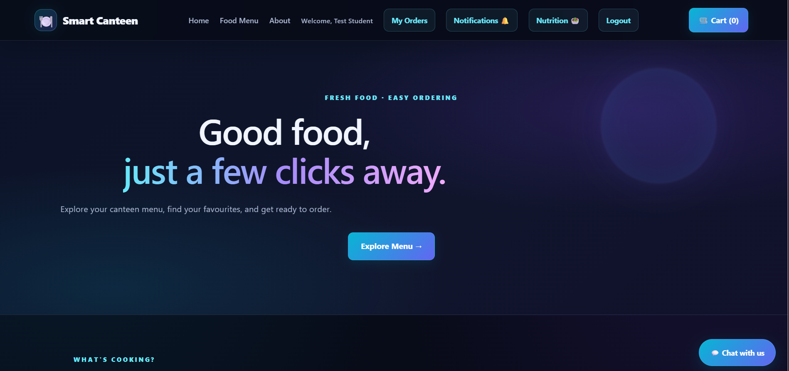

### 2. Food Menu

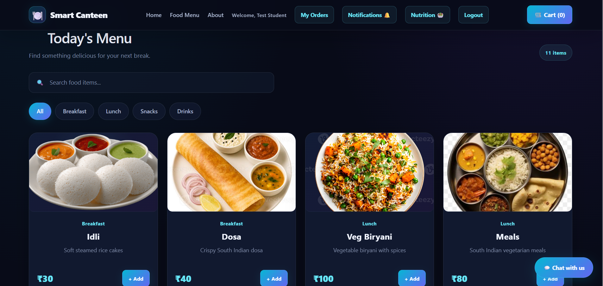

### 3. Student Login

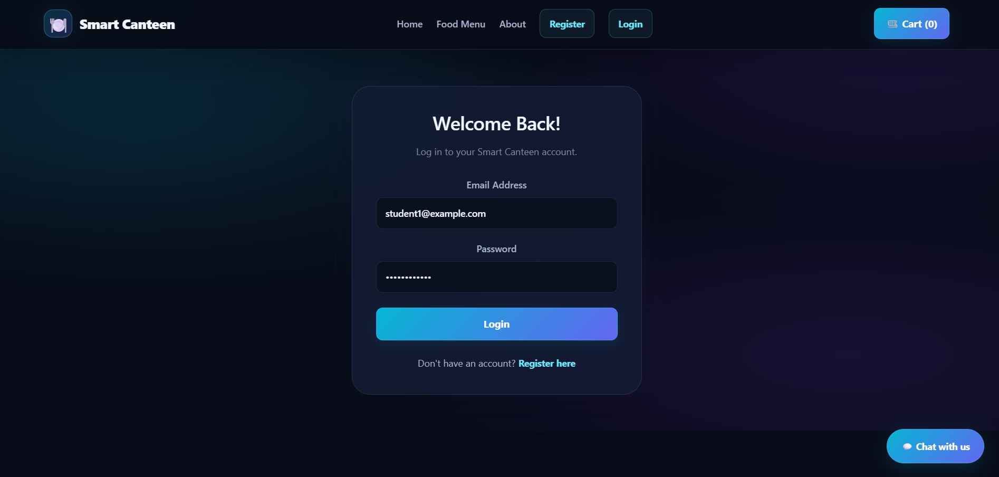

### 4. Student Registration

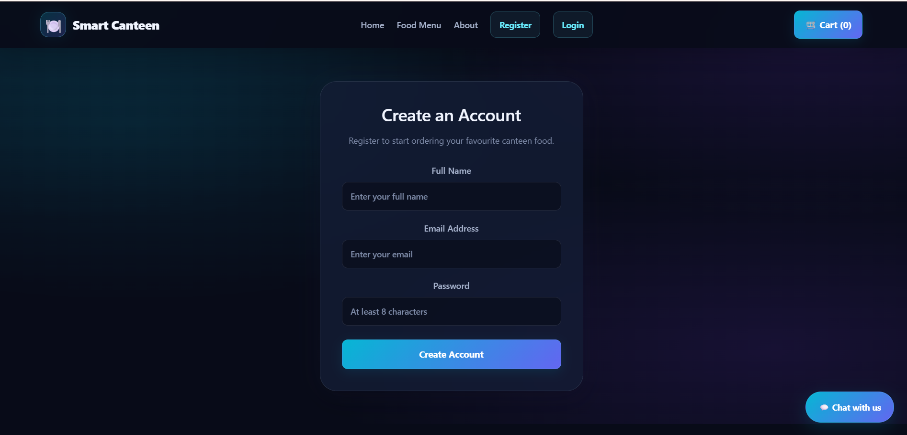

### 5. Shopping Cart

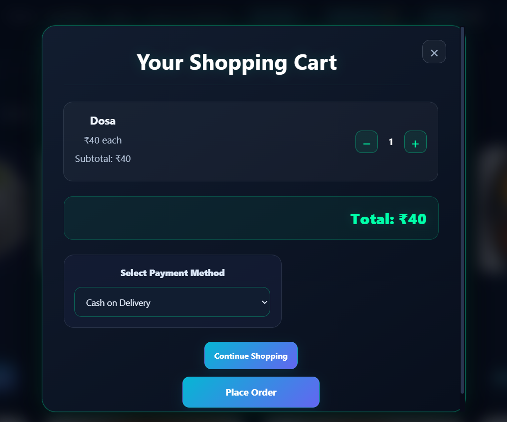

### 6. Order Details

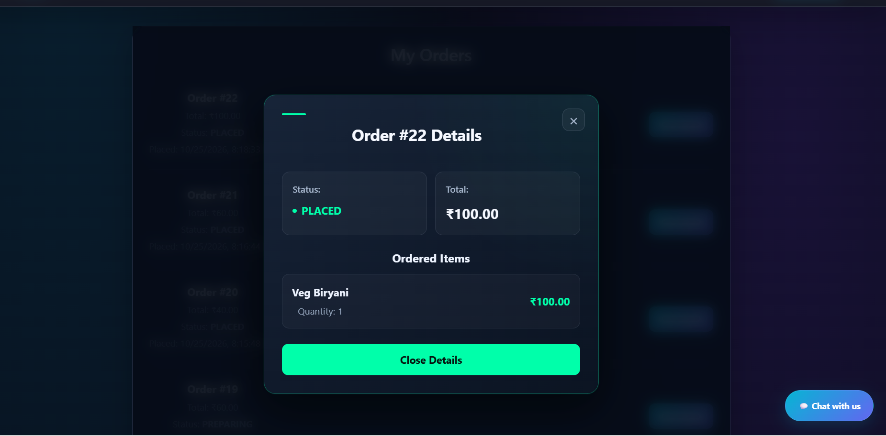

### 7. My Orders

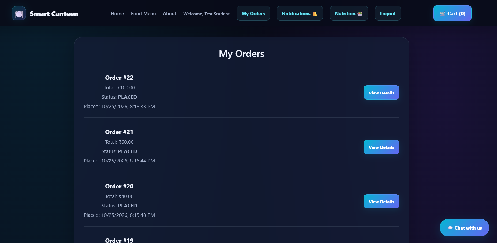

### 8. Admin Dashboard

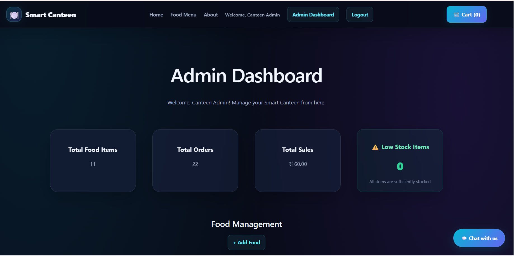

### 9. Add Food Items

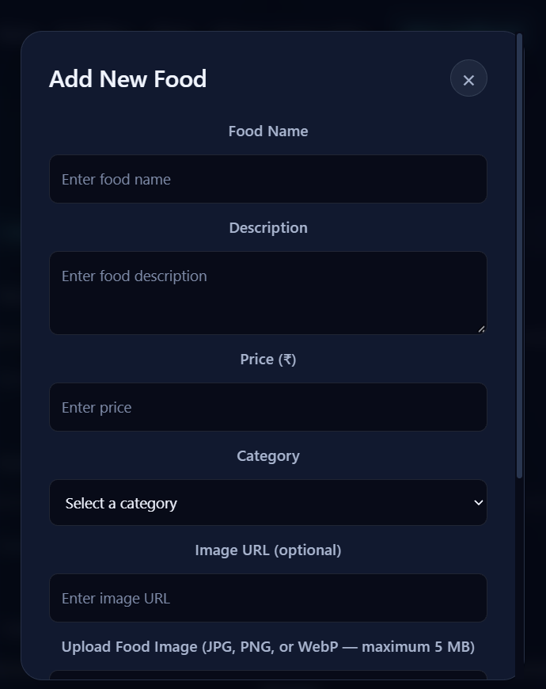

### 10. Food Management

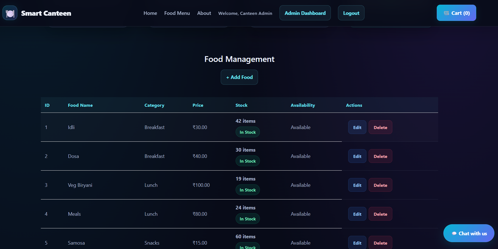

### 11. Order Management

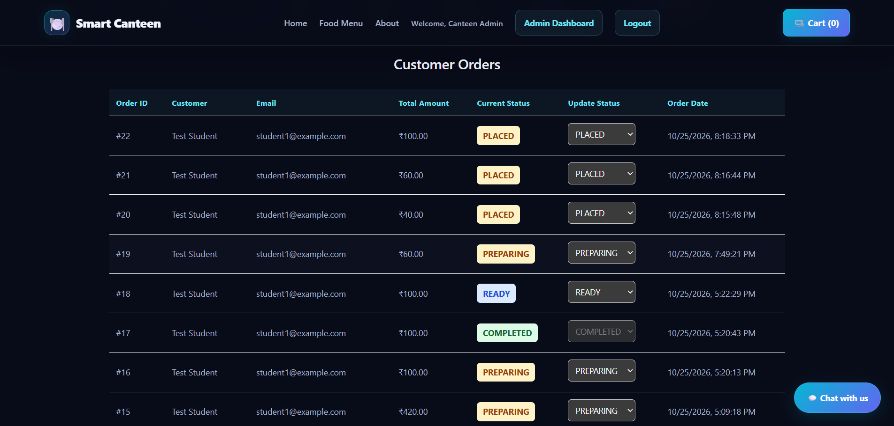

### 12. Food Nutrition Information

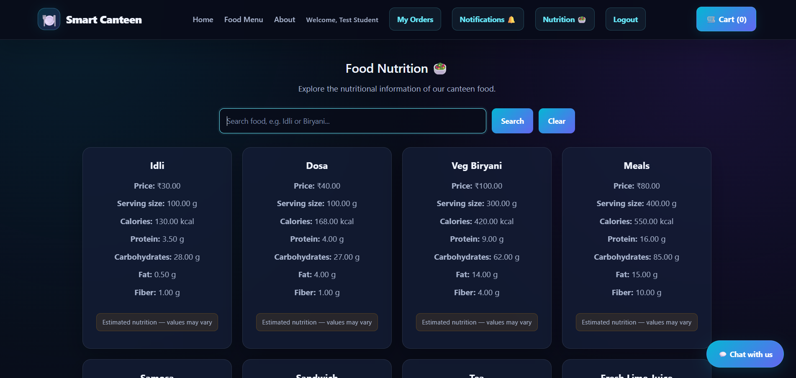

### 13. Notifications

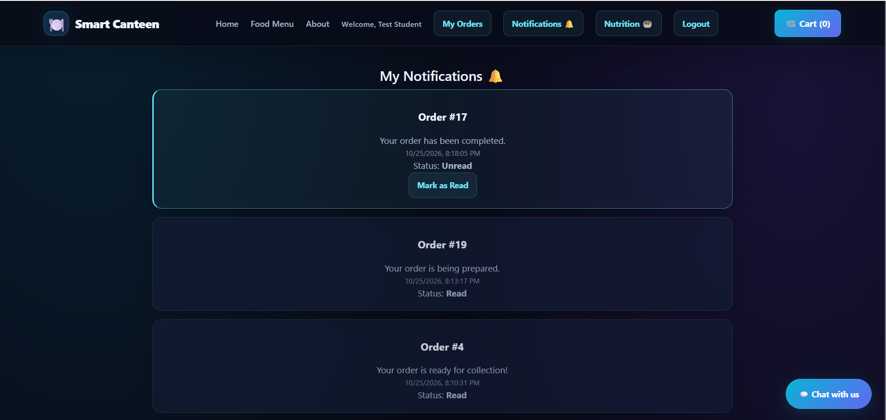

### 14. Chat Assistant

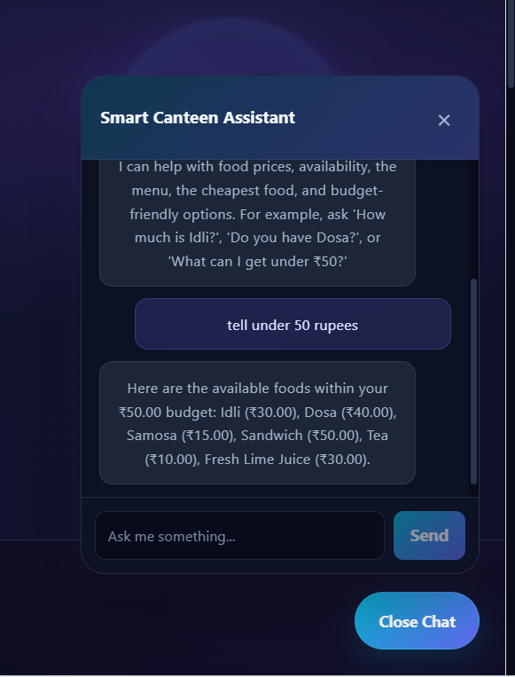

### 15. Application Completion Screen

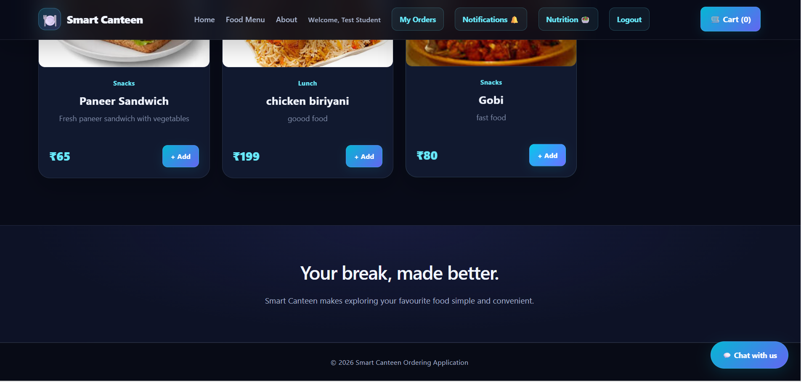
